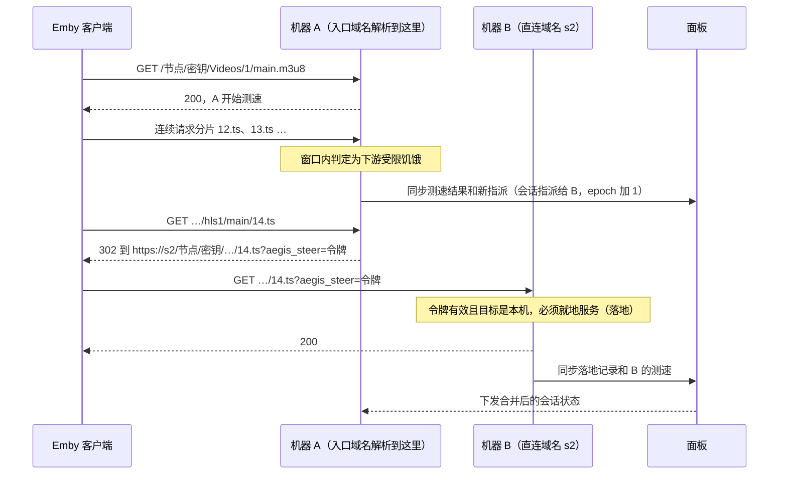

# 自动切流设计

状态：已实现（AegisRelay 0.11.0，探针能力 `steering-v1`；0.12.0 补充切换效果、网段历史、分段自动识别、入口域名自动配置与统一出口，探针能力 `entry-v1`、`egress-v1`）
依赖：Agent 协议 v1（[AGENT_PROTOCOL.md](AGENT_PROTOCOL.md)），探针 ≥ 0.10.21（配置长轮询）

## 0. 摘要

- 客户端通过**入口域名**访问：几台机器共用这个域名，由 DNS 按线路分发。每台机器另有一个只解析到自己的**直连域名**。
- 切流不搬迁已经建立的连接。它在**取流请求之间**用 `302` 把客户端引到另一台机器的直连域名。所有机器运行同一套判定，**哪台收到请求就由哪台决定**。
- 只有判定为**下游受限**（本机到客户端这段线路跟不上）时才切。如果是源站或转码慢就不切，因为所有机器都从同一个源站取流。
- 防抖手段：按时间窗口判定、切换后有最短停留时间、每次播放有切换次数上限、新目标必须明显更快、旧测速结果会过期作废。
- 每次播放的测速记录经面板在机器之间同步，延迟约 5 秒。面板离线时退化为各机器独立判断，最坏多一次跳转，不会形成跳转循环。
- 三种模式：关闭、只测不切、开启。直接播放的「主动分段」默认关闭，只对管理员点名的客户端启用。

## 1. 目标与非目标

### 1.1 目标

1. 同一次播放在线路变慢时自动换到更快的机器，并能随线路波动再次切换或切回。
2. 不修改 Emby 客户端，不要求用户手动换地址。
3. 判错的代价有上限：最坏是多一次跳转，或在一条稍差的线路上多停留一会儿，不能导致播放失败或跳转循环。
4. 不违背现有设计原则：探针只主动连接面板，不新增入站管理端口；面板不在播放数据路径上；面板离线不影响播放。

### 1.2 非目标（v1）

- 迁移正在传输的连接，或在一个响应中途无缝换机器。
- 因为**上游受限**而切换（各机器到源站线路质量不同的情况，留待后续）。
- LiveTV、WebSocket、浏览器里的 Emby Web 客户端。
- 把以 IP 模式（明文 HTTP）运行的机器作为切流目标。
- 客户端侧测速或多线路探测。
- `alias_only` 访问模式的节点：它们没有跨机器共享的 `routeAuthKey`，令牌无法跨机器校验。

## 2. 术语

| 术语 | 含义 |
|---|---|
| 入口域名 | 所有机器共用、由 DNS 按线路分发的域名，开启切流的节点以它作为客户端地址 |
| 直连域名 | 每台机器独有的 HTTPS 域名（即「代理机器」里的代理域名），只解析到这一台，是切流跳转的目标 |
| 播放会话 | 同一客户端对同一媒体的一次播放，各机器用同一个会话键识别它 |
| 决策点 | 可以就地服务、也可以跳转到别的机器的取流请求 |
| 指派 | 会话当前应由哪台机器服务；未指派时由收到请求的机器服务 |
| 落地 | 被跳转的请求到达了目标机器 |
| 下游受限 / 上游受限 | 瓶颈在本机到客户端 / 在本机到源站（含转码） |

## 3. 总体流程



要点：

1. 同一节点在所有机器上的路径和访问密钥相同（AGENT_PROTOCOL §1），所以跳转只换域名，路径和查询参数原样保留（逐字节，不重新编码）。
2. 现有的 `.aegis-relay/<令牌>` 续跳地址用节点的 `routeAuthKey` 加密，部署了该节点的机器都能解开。
3. API 请求（登录、PlaybackInfo、进度上报）始终由收到它的机器处理，只有取流请求会被跳转。
4. 如果跳转的是 HLS 播放清单，后续分片会直接发往新机器，因为清单里的相对地址按跳转后的地址解析。如果跳转的是单个分片，只影响这一个分片。

## 4. 前置：入口域名与直连域名

### 4.1 域名模型

- 全局设置 `entryDomain`（入口域名）在面板「自动切流」页配置。设置后，**真正在切流的节点**的客户端地址改用入口域名；其他节点不变。
  - 「真正在切流」指：总开关不是「关闭」、节点开启了自动切流且没有任何不满足的条件。
  - 节点还必须部署在**所有**可参与切流的机器上。面板让每台可参与的机器都服务入口域名，DNS 可能把客户端分到其中任何一台；少部署一台，被分到那台的客户端就会 404。缺哪台，「自动切流」页的节点列表会写明，对外地址也继续用直连地址。
- 每台机器在「代理机器」里配置的代理域名就是它的直连域名。直连域名与入口域名相同的机器不能参与切流（面板会提示需要单独的域名）。
- 参与切流的机器同时服务两个 Host：入口域名，以及自己的直连域名。面板机器的 Node 进程把入口域名当作数据面 Host 接受（`src/server.js` 的 `isEntryHost`）。

### 4.2 入口域名的 Nginx 与证书

入口域名解析到多台机器，`certbot --nginx`（HTTP-01 验证）发出的验证请求可能被 DNS 分发到别的机器，导致签发和续期随机失败；Let's Encrypt 现在会从多个网络位置同时验证，这个问题更容易出现。

方案：**转发 ACME 验证请求**（`scripts/configure-entry-domain.sh`）。

- 入口域名单独一个站点文件 `aegis-relay-entry.conf`，不改动直连域名现有的站点配置。
- 证书用 `certbot certonly --webroot` 签发，验证文件写到 `/var/lib/aegis-relay/acme`。
- 每台机器 80 端口上的 `/.well-known/acme-challenge/` 先查本地文件，查不到再依次转发给其他机器的直连域名（`proxy_next_upstream http_404`）。转发时带 `X-Aegis-Acme-Hop` 标记头，带着标记的请求只在本地查、不再转发，所以不会互相转发成环。
- 每台机器自己签发、自己持有私钥，不需要 DNS 服务商 API Token，私钥也不会在机器之间传递。

操作方式（0.12.0 起自动完成）：在「自动切流」页填写入口域名并保存即可。

- 面板为每台可参与的机器算出它要服务的入口域名、证书邮箱和转发验证请求的其他机器（`desiredEntry`），面板本机每 30 秒自检一次，探针（`entry-v1`）随 check-in 收到。
- 机器把请求写进数据目录的 `host-entry-request.json`，由 root 身份的受限主机单元（`aegis-relay(-agent)-entry.path` → `scripts/host-entry-apply.sh`）逐项复核后执行 `configure-entry-domain.sh`，结果写回 `host-entry-status.json`，随 check-in 回报面板。与域名切换使用同一套请求/状态文件机制，两者互斥，不会同时运行两个 certbot。
- 第一次签发通常要等所有机器都配好转发才能成功。失败的机器按 3、9、27、60 分钟退避重试，避免触发 Let's Encrypt 每小时的失败次数限制。
- 增减机器、机器换域名或关闭参与后，转发列表变化，各机器自动重新配置。
- 已签发的证书由 `certbot.timer` 续期，续期同样走 webroot 与转发。
- 旧版探针不会自动配置，页面仍给出手动命令（命令幂等，也可以随时手动重跑）：

```bash
sudo aegis-relay entry emby.example.com admin@example.com s2.example.com s3.example.com        # 面板机器
sudo aegis-relay-agent entry emby.example.com admin@example.com s1.example.com s3.example.com  # 探针机器
```

否决的方案：

- **DNS-01 验证**：每台机器都得存放 DNS 服务商 API Token，任何一台被攻陷都能篡改整个域名的解析。
- **一台签发、经面板分发证书**：私钥会离开签发它的机器，扩大单台机器被攻陷时的影响。
- 0.11.0 曾只提供手动命令，理由是入口域名一般只配置一次。实际上增减机器都要到每台机器重跑命令，0.12.0 改为经受限主机执行器自动下发。

### 4.3 切流目标的条件

一台机器要同时满足以下条件，才会出现在节点的切流拓扑里（`src/steering-topology.js`）：

- 「参与切流」开关为开（「自动切流」页的机器表，默认开）。关掉后这台机器既不接收、也不发出切流跳转。
- 有 HTTPS 直连域名（IP 模式不行），且直连域名不等于入口域名。
- 远程机器的探针声明了 `steering-v1` 能力（面板机器始终具备）。
- 部署了该节点。

此外，每次决策时目标机器还必须满足以下运行时条件（经 §10 同步）：

- 在线且代理健康，配置已同步（`appliedRevision` 等于 `desiredRevision`），健康信息在 60 秒以内；
- 已上报该节点的健康信息，且该节点在这台机器上的月度配额没有用完；
- 该节点在这台机器上当前使用的上游线路，与发起跳转的机器相同（见 §13.2）。节点设置了统一出口（§13.7）时不检查这一条，因为所有机器都经同一台出口机器访问上游。

## 5. 决策点

满足以下全部条件的请求才是决策点，其余请求一律就地服务：

- 方法是 `GET`。
- 是取流请求：`isPlaybackPath` 命中；字幕、图片、trickplay 等附属文件以及 `LiveTV` 路径除外。
- 经 HTTPS 进入（`x-forwarded-proto` 为 `https`）。
- 不带 `Authorization` 头。客户端跨域名跳转时可能会丢掉这个头；Emby 的取流地址通常在查询参数里带 `api_key`，不受影响。
- 能识别出播放会话（§6）。
- 不是浏览器（`User-Agent` 以 `Mozilla/` 开头的一律不参与），客户端名称（`X-Emby-Client`）也不在排除名单里（§11.3）。
- 节点在这台机器的快照里带有切流拓扑（即全局模式不是「关闭」、节点开启了切流、没有限速、至少两台可参与的机器部署了它）。

决策点分三类：

- **播放清单**（`.m3u8`）：跳转后后续分片直接去新机器；本机服务时从清单里读出分片时长。
- **HLS 分片**（`.ts`、`.m4s`、`/hls*/` 下的请求）：按请求节奏测速（§7.1）。
- **渐进式**：直接播放和直接串流，按每秒采样测速（§7.2）。

## 6. 播放会话识别

```text
steerKey   = HKDF-SHA256(routeAuthKey, info="AegisRelay:steer:v1")
sessionKey = base64url( HMAC-SHA256(steerKey, "session\n" ‖ itemId ‖ MediaSourceId ‖ PlaySessionId ‖ DeviceId)[0:16] )
```

- `itemId` 取自路径 `/Videos/{itemId}/`、`/Audio/{itemId}/` 或 `/Items/{itemId}/Download`。其余字段从查询参数（不区分大小写）或 `X-Emby-Device-Id` / `X-Emby-Authorization` 请求头读取。
- 至少要有 `PlaySessionId` 或 `DeviceId` 中的一个。没有时，沿用这台机器上同一节点、同一媒体最近一次识别出的会话键（应对分片地址不带会话参数的情况）。仍然没有就不参与切流。
- 被跳转过来的请求，会话键直接取自令牌，因此目标机器不依赖地址里有没有会话参数。
- 不用客户端 IP 识别会话：同一客户端连不同机器时可能分别走 IPv4 和 IPv6，而且没必要让面板保存客户端 IP。
- 面板和日志里只出现哈希后的会话键。

## 7. 测速与判定

判定结果只有四种：

| 判定 | 含义 | 是否触发切换 |
|---|---|---|
| `ok` | 客户端跟得上 | 否 |
| `starved_down` | 下游受限饥饿：客户端一直在取数据但跟不上，瓶颈在本机到客户端 | 是 |
| `starved_up` | 上游受限饥饿：瓶颈在源站或转码 | 否，只记录 |
| `unknown` | 数据不够，或者客户端处于空闲（暂停、缓冲已满） | 否 |

### 7.1 HLS：按请求节奏判定

HLS 分片通常只有几 MB，会被内核发送缓冲区直接吃下，在 Node 层测到的写出速度会远高于实际速度，不能直接用。改为看客户端的请求节奏：播放器收完一个分片才会请求下一个，所以「下一个请求到达的时间」就是客户端真正收完上一个分片的时间。

对每个分片 N 记录：

- `C`：从收到分片 N 的请求，到收到分片 N+1 的请求所用的时间，即客户端的完整周期。下一个请求被跳到了别的机器时，这个样本作废。
- `U`：其中花在上游的时间 = 上游响应头到达前的等待（转码） + 之后未被下游背压阻塞的传输时间（每秒采样 `res.writableNeedDrain`）。

判定窗口至少 20 秒，并按分片时长自动加长到能容纳 4 个分片（`max(20 秒, 4 × 分片时长 × 2)`），否则 6 秒分片在饥饿时永远凑不够样本：

- **媒体时间比** `r = 分片数 × 分片时长 / ΣC`。分片时长取自经本机转发的播放清单里的 `#EXT-X-TARGETDURATION`（边转发边旁路读取，支持 gzip/deflate/br，不延迟交付）；清单不经过本机时，从同步来的会话状态获取。`r ≥ 1` 表示缓冲在增加或持平；`r < 1` 表示缓冲在消耗。
- **下游占比** `d = Σ(C − U) / ΣC`。

| 条件 | 判定 |
|---|---|
| 不知道分片时长，或窗口内少于 4 个分片 | `unknown` |
| `r ≥ 0.9` | `ok` |
| `r < 0.9` 且 `d ≥ 0.5` | `starved_down` |
| `r < 0.9` 且 `d < 0.5` | `starved_up` |

速率估计用于比较不同机器：`Σ分片字节数 / ΣC`。

### 7.2 渐进式：按每秒采样判定

直接播放的响应很长，持续传输时 Node 层的背压能如实反映客户端的接收能力。每个会话在本机的所有活跃响应每秒采样一次（全进程共用一个定时器）：

- `idle`：这一秒没有字节写出且下游处于背压（播放器缓冲满或用户暂停），或者会话在本机没有活跃响应。
- `blocked`：采样时 `res.writableNeedDrain` 为真。
- 会话在本机 15 秒没有任何响应时视为已离开，停止采样；再回来时清空旧样本。

在最近 120 秒内判定：

| 条件 | 判定 |
|---|---|
| 不足 120 秒 | `unknown` |
| `idle` 超过 5% | `ok` |
| `idle` ≤ 5% 且 `blocked` ≥ 70% | `starved_down`（节点设了「最低速率」且实际速率不低于它时改判 `ok`） |
| `idle` ≤ 5% 且 `blocked` < 30%（数据在等上游） | `starved_up` |
| 其他 | `unknown` |

依据：线路比码率快时，播放器迟早会填满缓冲、停下来等，于是出现空闲秒；线路跟不上码率时，播放器永远填不满缓冲，会一直读。窗口取 120 秒，是为了跳过起播阶段的连续填充（ExoPlayer 默认最多缓冲约 50 秒）。

已知局限：缓存非常大的播放器（例如把缓存调到 GB 级的 mpv），在线路只比码率略快时也可能长时间没有空闲秒而被误判。切换只发生在本来就会出现的请求处，换过去之后会重新测速，判断错了会再纠正；也可以给节点设「最低速率」。

## 8. 切换决策（`decide`，`src/steering.js`）

### 8.1 会话状态

| 字段 | 含义 |
|---|---|
| `assigned` | 当前指派的机器；为空表示由收到请求的机器服务 |
| `epoch` | 指派版本号，每次重新指派加 1 |
| `lastSwitchAt` / `switches` | 最近一次切换的时间，以及最近的切换记录 |
| `scores[机器]` | 各机器对这个会话最近一次测量的判定、速率和测量时间 |
| `tried[机器]` | 最近一次试探某台机器的时间 |
| `segmentSeconds` | HLS 分片时长（如有） |
| `lastLanding` | 最近一次确认落地的 epoch 和时间 |

会话 30 分钟没有请求即过期。

### 8.2 算法

机器 M 收到属于会话 S 的决策点请求 R 时：

1. **落地请求就地服务**：R 带有 30 秒内签发、校验通过、目标是 M 的切流令牌，就地服务并记录落地，到此结束。**一个请求最多被切流跳转一次**，这条规则保证不会出现跳转循环。
2. **确定当前目标**：`target = S.assigned ?? M`。如果 `target ≠ M`，但 target 已经不满足 §4.3 的运行时条件，就清除指派（`epoch` 加 1），令 `target = M`。
3. **判断是否需要重新指派**。距 `lastSwitchAt` 不足 120 秒、或近 10 分钟内已切换 3 次，直接到第 5 步。否则：
   - `scores[target]` 的判定是 `starved_down`、且测量在 60 秒以内：进入第 4 步。
   - 否则只检查**网段历史**（§8.4）：会话从没切换过、当前机器还没测出 `ok`，并且这个客户端网段在当前机器上一直卡（至少 3 个样本，正常占比 ≤ 34%）、在另一台候选上一直好（至少 3 个样本，正常占比 ≥ 75%），就切到正常占比最高的那台（原因 `history`）。不满足就到第 5 步。
4. **选择新目标**。候选是满足条件、且不是当前 target 的机器，M 自己也算候选：
   1. 10 分钟内被判为 `starved_down` 的候选跳过。
   2. 10 分钟内判定为 `ok`、速率 ≥ 当前 target 速率 × 1.3 的候选里，选速率最高的一台。
   3. 否则，在没有有效测速结果的候选里去试：先试这个网段历史上正常占比最高的（样本不足 3 个的按 50% 算），一样时选最久没被试过的。
   4. 都没有就保持现状。
5. **执行**：`target = M` 时就地服务并测速；否则返回 302 跳转到 target（§9）。

「只测不切」模式下执行完全相同的判断，但只针对当前实际服务的机器、只记录「本应切换」，从不跳转，也不改变指派。

性质：

- **只在当前线路变差时才切**，不会因为别的线路「可能更快」就主动切走，这是防止来回切换的根本手段。
- 切回原机器不需要特殊处理：10 分钟后原机器的差评作废，下次当前线路变差时，它又会成为候选。
- 判定只看 60 秒内的测量，线路短暂波动留下的差评会自动失效。
- 网段历史只在开播前（会话从没切换过）主动引发一次切换，其余时候只影响「先试哪台」，不会让正常播放的会话被切走。

### 8.4 网段历史

- 探针把客户端地址（取 Nginx 设置的 `X-Real-IP`）缩成网段（IPv4 /24、IPv6 /48），再用该节点的切流密钥做 HMAC，只上报 16 字符的摘要 `p`，地址本身不离开机器。
- 面板按「节点 + 网段摘要」记录每台机器的正常占比：判定为 `ok` 计 1、`starved_down` 计 0，`starved_up`（源站慢）不计。每个会话在每台机器上每分钟最多计一个样本，前 5 个样本取平均，之后按 0.2 的权重滑动平均。
- 只存在面板内存里，最多 5000 个网段，7 天没有新样本即失效，面板重启后清空。
- 面板随会话下发 `prior`（各机器的正常占比和样本数），供 §8.2 使用。

### 8.3 参数默认值（`STEER_DEFAULTS`）

| 参数 | 默认值 |
|---|---|
| HLS 判定窗口 | 至少 20 秒，并能容纳 4 个分片 |
| 渐进式判定窗口 | 120 秒 |
| 测量有效期 | 60 秒 |
| 切换后最短停留 | 120 秒 |
| 切换次数上限 | 10 分钟内 3 次 |
| 新目标速率优势 | 1.3 倍 |
| 差评冷却 | 10 分钟 |
| 切流令牌有效期 | 30 秒 |
| 跳转落地超时 | 15 秒 |
| 会话过期 | 30 分钟无请求 |
| 状态同步间隔 | 有活跃会话时每 5 秒，空闲时每 30 秒；有决策或落地时 0.5 秒内提前同步 |
| 其他机器健康信息有效期 | 60 秒 |
| 网段历史生效的最少样本 | 3 个 |
| 网段历史：当前机器「一直卡」/ 另一台「一直好」 | 正常占比 ≤ 34% / ≥ 75% |
| 分段后等待接续 | 30 秒 |

面板只开放「最低速率」（按节点）一项，其余是代码常量，按「只测不切」阶段的实测数据再校准。

## 9. 跳转与防环

### 9.1 跳转响应

```http
HTTP/1.1 302 Found
Location: https://<目标直连域名>/<别名>/<访问密钥><原路径>?<原查询参数，去掉旧令牌>&aegis_steer=<令牌>
Cache-Control: no-store
```

- 用 `302`，不用 `301` / `308`，避免客户端永久缓存这个跳转。
- 用户渠道密钥会被保留，所以渠道归属和流量统计不变。
- 跳转本身计入发起机器的请求数，不计流量。

### 9.2 切流令牌

```text
token = base64url( ver(1) ‖ epoch(4) ‖ issuedAt(4) ‖ H(targetAgentId)[0:8] ‖ sessionKey(16) ‖ mac(16) )
mac   = HMAC-SHA256(steerKey, "token\n" ‖ 前面各字段)[0:16]
```

- 编码后 66 个字符，放在查询参数 `aegis_steer` 里。
- 每台机器在转发给上游之前，从查询串里**逐字节**删掉 `aegis_steer`（不论该节点是否开启切流），其他查询参数原样保留。
- 令牌只表示「这是一次刚发出的切流跳转，目标是你」，不授予任何访问权限。客户端本来就可以用同一个访问密钥直接访问任何一台机器的直连域名。
- 基于 ffmpeg 的播放器会在后续请求里一直沿用跳转后的地址，令牌也跟着反复出现；令牌 30 秒后失效，之后这些请求按普通请求参与决策。
- 时钟：探针从每次同步响应的 `serverTime` 得知与面板的时差，令牌和测速时间统一按面板时间计算。

### 9.3 落地确认与熔断

- 目标机器收到带令牌的请求，记一次落地并尽快同步给面板。
- 跳转发出 15 秒后仍未确认落地，视为失败：发起机器清除这个会话的指派，并把目标机器对这个会话记为 `starved_down`，使它进入冷却。
- 面板按客户端名称统计每次重新指派的结果（成功落地或超时）。某个客户端在最近 20 次里至少有 10 次记录、且成功率低于 80%，就被**自动排除**，并在「自动切流」页提示；管理员可以一键清空自动排除。

### 9.4 状态不一致时

同步有约 5 秒延迟，各机器看到的会话状态可能暂时不一致。例如 A 认为会话在 B，B 已经把它改派给 C 但 A 还不知道：A 把请求跳到 B，B 按 §8.2 第 1 步必须就地服务。结果只是这一个请求由 B 服务，同步完成后恢复一致。

**状态不一致最多导致一个请求没被分到最合适的机器，不会产生跳转循环。**

## 10. 跨机器状态同步

### 10.1 端点

`POST /api/agent/v1/steering`，签名、时间戳和 nonce 规则与 `check-in` 相同，请求体上限 512 KiB。只有声明了 `steering-v1` 能力、且快照里至少有一个节点带切流拓扑的探针才会调用。面板机器自己在进程内直接调用同一个 `SteeringHub.exchange`。

请求：

```json
{
  "protocolVersion": 1,
  "cursor": 1842,
  "reports":   [{"s":"<会话键>","r":"<节点 id>","verdict":"starved_down","rateBps":1250000,"at":1793200000000,"segmentSeconds":6,"client":"Emby for Android","p":"<网段摘要>"}],
  "decisions": [{"s":"<会话键>","r":"<节点 id>","assigned":"<机器 id>","epoch":7,"switched":true,"from":"<机器 id>","reason":"explore","fromRateBps":1250000,"toRateBps":0,"client":"…","at":1793200001000}],
  "landings":  [{"s":"<会话键>","r":"<节点 id>","epoch":7,"client":"…","at":1793200002000}],
  "failures":  [{"s":"<会话键>","r":"<节点 id>","epoch":7,"target":"<机器 id>","client":"…","at":1793200017000}],
  "shadow":    [{"s":"<会话键>","r":"<节点 id>","from":"<机器 id>","to":"<机器 id>","reason":"explore","fromRateBps":0,"toRateBps":0,"client":"…","at":1793200001000}],
  "bounds":    [{"s":"<会话键>","r":"<节点 id>","client":"…","continued":true,"trial":false,"at":1793200040000}],
  "health":    {"routes":{"<节点 id>":{"line":0,"quotaExhausted":false}}}
}
```

响应：

```json
{
  "protocolVersion": 1,
  "serverTime": 1793200003000,
  "cursor": 1850,
  "sessions": [{"s":"…","r":"…","assigned":"…","epoch":7,"lastSwitchAt":0,"switches":[],"scores":{"<机器 id>":{"verdict":"ok","rateBps":4000000,"at":0}},"tried":{},"segmentSeconds":6,"lastLanding":{"epoch":7,"at":0},"lastSeen":0,"prior":{"<机器 id>":{"ok":0.9,"n":4}}}],
  "peers":    [{"id":"<机器 id>","healthy":true,"at":1793200000000,"routes":{"<节点 id>":{"line":0,"quotaExhausted":false}}}],
  "excludedClients": ["…"],
  "boundedClients": [],
  "trialClients": [],
  "boundBytes": 67108864
}
```

- 时间单位为毫秒（面板时间）。
- 面板只返回 `cursor` 之后有变化、且属于这台机器所部署节点的会话；每次最多 200 条，超出部分下次继续。面板重启后旧 cursor 无效，从头发送。
- 同步失败时，决策、落地和失败记录放回队列下次重发，指数退避到最多 5 分钟。

### 10.2 面板侧（`src/steering-hub.js`）

- 会话状态只存在内存里，不写入加密存储，过期自动清除。面板重启后所有会话回到未指派状态，不影响正在进行的播放。
- 合并规则：
  - 测量只接受上报机器关于自己的那一项（`scores[上报机器]`）。
  - 指派以 `epoch` 大的为准，`epoch` 相同时先到先得；后到的被拒绝，面板在同一个响应里下发正确状态，探针按「同 epoch 以面板为准」纠正。
  - 指派目标必须是部署了该节点的机器；上报机器也必须部署了对应节点，否则该条被忽略。
- 自动排除的客户端写入加密存储（`settings.steering.autoExcluded`），重启后仍然有效。
- **切换效果**：真实切换（`on`）等目标机器的第一个非 `unknown` 判定：`ok` 记为卡顿解除（并记录相对切换前速率的倍数），`starved_down` 记为仍然卡顿，`starved_up` 记为源站慢；没跟随跳转的记为「没跟随跳转」，10 分钟没有结论的记为「未测到」。「只测不切」的本应切换，看原机器：3 分钟内测出 `ok` 记为自行恢复，2 分钟后仍不是 `ok` 记为持续卡顿。各保留最近 200 条，只在内存里。
- **分段接续**：机器把每次分段（§15 第 3 期）的结果放进 `bounds`。管理员列出的或自动加入的客户端，最近 10 次里至少 3 次、且接续成功率低于 80% 时被自动停用（`settings.steering.autoUnbounded`）。开启「自动识别」后，面板把稳定跟随切流跳转（最近至少 5 次、落地率 ≥ 90%）且尚无结论的客户端放进 `trialClients` 试探：连续 3 次接续成功自动加入（`autoBounded`），一次失败即停止试探。

### 10.3 面板离线

探针继续用本地已知的状态做决策。其他机器的测量和指派传不过来，效果退化为「各机器独立判断」；对端健康信息超过 60 秒后不再视为可用目标，于是跳转自然停止。§9.4 的保证依然成立。

### 10.4 拓扑信息放进快照

开启切流的节点，在发给参与机器的快照里增加：

```json
"steering": {"mode":"shadow","peers":[{"id":"<机器 id>","base":"https://s2.example.com"}],"params":{"minRateMbps":0}}
"egress":   {"id":"<出口机器 id>","base":"https://s1.example.com"}
```

- `egress` 只发给部署了该节点、但不是出口机器本身的机器，与切流模式无关（§13.7）；设置了统一出口时 `steering.params` 多一项 `"anyLine":true`。

- 这一项放在节点对象内部，因此受快照哈希和签名保护（`verifySnapshot` 校验 `schemaVersion`、`revision`、`nodes`），不需要提升快照格式版本。
- 不参与切流的机器（包括旧探针）拿到的快照不变，不会因此产生新的 revision。
- 快照里只放不常变的拓扑。在线状态、配额、上游线路走 §10.1 的同步。
- 以下变化会立即重新编译所有机器的快照：切流设置、节点的切流开关或统一出口、机器的部署或参与开关、新机器注册、机器的能力（`steering-v1`、`egress-v1`）或直连域名变化（check-in 时检测）。

## 11. 配置与面板

### 11.1 配置项

| 位置 | 配置 | 默认 |
|---|---|---|
| 「自动切流」页 | 模式：关闭 / 只测不切 / 开启 | 关闭 |
| 「自动切流」页 | 入口域名 | 空 |
| 「自动切流」页 | 不参与切流的客户端 | 空（浏览器始终不参与） |
| 「自动切流」页 | 分段播放的客户端、每段大小 | 空、64 MB（§15 第 3 期） |
| 「自动切流」页 | 自动识别能接续分段的客户端 | 关闭 |
| 「自动切流」页 › 机器表 | 参与切流 | 开启 |
| 节点编辑 › 高级设置 | 自动切流、最低速率（Mbps） | 关闭、0 |
| 节点编辑 › 高级设置 | 统一上游出口（§13.7） | 不使用 |

### 11.2 面板展示

- 机器表：每台机器能否参与，以及不能参与的原因（没有直连域名、与入口域名相同、探针需要升级、已关闭参与）。
- 每台机器的入口域名配置状态（等待执行 / 正在配置 / 已生效 / 失败及重试次数），以及手动命令（§4.2）。
- 节点表：每个节点是否正在切流、不能切流的原因、哪台入口机器没部署它，以及统一出口是否生效。
- 切换效果：真实切换的卡顿解除比例和中位提速、各机器对的统计；只测不切的持续卡顿 / 自行恢复比例；已积累历史的网段数。
- 最近决策：时间、节点、从哪台到哪台、原因、前后速率；「只测不切」的记录标为「本应切换」。
- 正在播放：会话（哈希前缀）、当前机器、各机器的判定和速率。
- 客户端跳转落地率，以及被自动排除的客户端。
- 分段接续：各客户端分段后的接续次数、试探结果和当前状态。

### 11.3 客户端排除

浏览器（`User-Agent` 以 `Mozilla/` 开头，包括 Emby Web 和基于 Electron 的客户端）始终不参与：跨域跳转涉及 CORS 和凭据处理，不确定因素太多。其余客户端默认参与，不兼容的由 §9.3 的落地率熔断自动排除，管理员也可以手动排除。

## 12. 安全与隐私

- **不扩大访问范围**：跳转目标是同一节点、同一访问密钥在另一台机器上的地址，客户端本来就能直接访问。令牌不携带、也不授予任何凭据。
- **令牌无法伪造**：MAC 使用从节点 `routeAuthKey` 派生出的独立密钥，与续跳令牌的 AES-GCM 密钥分开。只有部署了该节点的机器能签发和校验。
- **单台机器被攻陷**：攻击者只能在部署了同一节点的机器之间误导会话指派，或上报虚假测速，让播放变慢；不会泄露其他节点的数据或任何凭据。
- **隐私**：面板只保存哈希后的会话键、机器 id、速率和客户端名称，不保存客户端 IP、设备 ID 或访问密钥。网段历史只用按节点密钥计算的网段摘要（§8.4），且只在内存里。`aegis_steer` 和统一出口的转发头都不会转发给上游。
- **统一出口的转发**：转发头里的凭证由节点密钥派生、按分钟变化（容许前后 2 分钟的时钟误差），只有部署了该节点的机器能生成；出口机器只在凭证有效时才采信转发头里的客户端域名。伪造的转发头会被删除并忽略。
- **入口域名自动配置**：请求来自无特权的容器，主机脚本对每个字段重新校验（域名格式、邮箱、最多 16 台其他机器、尝试次数），不合格的请求直接丢弃，只调用固定路径下的 `configure-entry-domain.sh`。
- **不新增入站端口**：机器之间不直接通信，所有同步都经过面板（AGENT_PROTOCOL §2 第 1 条）。入口域名的证书验证转发只涉及 80 端口上的 `/.well-known/acme-challenge/` 路径，只读、且每个请求最多转发一次。

## 13. 风险与限制

### 13.1 上游的多 IP 风控（重要）

切流后，上游看到的来源 IP 会在播放中途从机器 A 变成机器 B。部分公益服会把「同一账号短时间内从多个 IP 播放」视为共享账号并封禁。因此切流默认关闭、按节点单独开启，只应用在自有或已获授权、并且不会因来源 IP 变化而处罚的上游上。面板的节点编辑和「自动切流」页都有提示。需要对这类上游切流时，给节点设置统一出口（§13.7）。

### 13.2 转码会话与上游线路

`orderedTargets` 刻意让同一节点始终优先走主线路，因为把拖动请求发到另一台 Emby 服务器会找不到原来的转码会话。切流有同样的风险，所以目标机器对该节点当前使用的线路必须与发起机器相同（`activeUpstreamLine`，经同步的 `health.routes[].line` 比较）。

### 13.3 测量误判

见 §7.2 的已知局限。先用「只测不切」观察，切换也只发生在本来就会出现的请求处，误判的代价有上限。

### 13.4 限速节点

开启了限速的节点，速度是被本机人为压低的，会被误判为下游受限，因此限速节点不能开启切流。

### 13.5 配额

配额按机器独立计算（AGENT_PROTOCOL §2 第 9 条）。切过去的流量计入目标机器；目标机器的配额用完后，不再作为候选。

### 13.6 目标机器在跳转后宕机

基于 ffmpeg 的播放器会一直沿用跳转后的地址。目标机器宕机后，它们会一直连不上，直到用户重新开始播放（重新播放时会回到入口域名）。运行时健康条件可以降低跳到故障机器的概率，但无法完全避免。

### 13.7 统一上游出口

节点可以指定一台「统一出口机器」。部署该节点的其他机器不再自己连上游，而是把客户端请求的原路径（含节点别名和访问密钥）原样转给出口机器的直连域名，由出口机器校验密钥后连上游，上游只会看到出口机器的 IP。

- 所有请求都走出口机器：API、播放、WebSocket，以及 `.aegis-relay` 续跳和 `.aegis-vod` 链接（这些链接由出口机器签发和解析，转发的机器不读它们）。
- 转发时带上客户端实际访问的域名（`X-Aegis-Egress-Host`）和凭证（`X-Aegis-Egress`，§12）。出口机器据此为这个域名生成重定向和改写后的链接，客户端始终留在它连接的那台机器上；出口机器不对转发来的请求做切流、不重复计流量和访客，也不检查配额（由客户端连接的机器负责）。
- 只有当每台部署该节点的机器都声明了 `egress-v1`、出口机器有 HTTPS 直连域名、节点开启了连接密码时才生效。任何一台旧版探针自己连上游都会带回第二个 IP，所以此时整体不生效，并在「自动切流」页写明原因。
- 与切流模式无关：总开关为「关闭」时同样生效。
- 代价：经出口机器多一跳流量（出口机器的上下行都会增加）；出口机器离线时，其他机器上的该节点也无法播放。

## 14. 代码结构

| 文件 | 职责 |
|---|---|
| `src/steering.js` | 数据面引擎：会话键与令牌、网段摘要、统一出口凭证、§7 的判定、§8 的 `decide`（纯函数）、`SteeringEngine.plan`（决定就地服务还是跳转）、测速采样、分段接续判定、同步载荷的导出与合并 |
| `src/steering-hub.js` | 面板侧会话仲裁、对端健康、决策事件、客户端落地率、切换效果、网段历史、分段接续统计 |
| `src/steering-topology.js` | 设置的规范化、机器/节点能否参与及原因、快照拓扑（含统一出口）、入口域名地址与各机器的入口配置 |
| `src/domain-control.js` | 面板本机的入口域名请求文件 |
| `scripts/host-entry-apply.sh` | 受限主机单元：复核请求后配置入口域名 |
| `src/proxy.js` | `makeProxyHandler(…, steering)`：所有请求删除 `aegis_steer`；取流请求调用 `plan`；向测速对象报告响应头、字节和清单内容；`activeUpstreamLine` |
| `src/agent-api.js` | `POST /api/agent/v1/steering`；注册和 check-in 时检测拓扑变化并重新编译快照 |
| `src/agent-main.js` | 声明 `steering-v1`、`entry-v1`、`egress-v1`，运行引擎和同步循环，跟随面板下发的入口配置 |
| `src/server.js` | 面板机器的引擎与 hub；`/steering` 管理接口；入口域名按数据面 Host 处理 |
| `src/snapshot.js`、`src/local-agent.js` | 快照里的 `steering` 拓扑块，以及运行时路由映射 |
| `scripts/configure-entry-domain.sh` | 入口域名的 Nginx 站点、webroot 证书与 ACME 验证转发；由 `aegis-relay entry` / `aegis-relay-agent entry` 调用 |
| `web/` | 「自动切流」页、节点编辑里的自动切流开关 |

测试：`test/steering.test.js`（判定、决策、令牌、网段、分段接续、引擎）、`test/steering-hub.test.js`（hub、切换效果、网段历史、拓扑、快照、统一出口、入口配置）、`test/steering-proxy.test.js`（经真实 HTTP 中继的跳转与落地）、`test/egress.test.js`（经真实 HTTP 的统一出口转发）、`test/entry-control.test.js`（面板本机入口请求）、`test/agent-api.test.js`（签名同步端点、入口配置下发）、`test/nginx-template.test.js`（入口域名配置）。

## 15. 上线步骤

### 第 0 期：验证与前置

1. **手动对比**：播放慢的时候，在客户端里把地址手动换成另一台机器的直连域名，播同一部片子。如果没有明显变快，说明瓶颈在源站，切流帮不上忙。
2. **升级**：面板升级到 0.12.0，每台探针执行 `sudo aegis-relay-agent update`（面板会标出待升级的机器）。
3. **域名**：给每台机器配置独立的直连域名；入口域名的 DNS 按线路分发到各台机器；在「自动切流」页填写入口域名并保存，各机器会自动配置，在页面上等每台都显示「已生效」（旧版探针执行页面给出的 `entry` 命令）。
4. **兼容性**：用实际在用的客户端各播放几次，观察「客户端跳转落地率」。

### 第 1 期：只测不切

模式设为「只测不切」，节点开启自动切流。观察「最近决策」里「本应切换」的记录是否与实际卡顿吻合、正常播放时有没有误报；「切换效果」里持续卡顿的占比越高，说明开启越有用，自行恢复占多数则说明多是短暂波动。

### 第 2 期：开启

模式设为「开启」。切换只发生在本来就会出现的请求上：HLS 的播放清单和分片，渐进式播放的每个 `Range` 请求。关注落地率、「切换效果」里的卡顿解除比例和中位提速，以及上游是否出现风控。

### 第 3 期：直接播放分段（按客户端启用）

把经过测试、能自动接续分段的客户端名称填入「分段播放的客户端」。对这些客户端的直接播放，开放式 `Range` 请求（`bytes=N-`）会被限制为每次一段（默认 64 MB），播放器自己请求下一段，每段之间都是一次切换机会。未经测试的客户端可能把一段当成文件结尾而提前结束播放，所以默认不对任何客户端启用。

- 每次分段后 30 秒内播放器回来请求下一个字节，算接续成功。接续失败率超过 20% 的客户端会被自动停用分段（「清空分段自动结果」可恢复）。
- 也可以开启「自动识别能接续分段的客户端」：只试探稳定跟随切流跳转的客户端，每台机器同一时间只试一个会话，每个会话只试一次；连续 3 次成功自动加入，一次失败即停止。代价是试探失败时那一次播放会在分段处停下，所以默认关闭。
